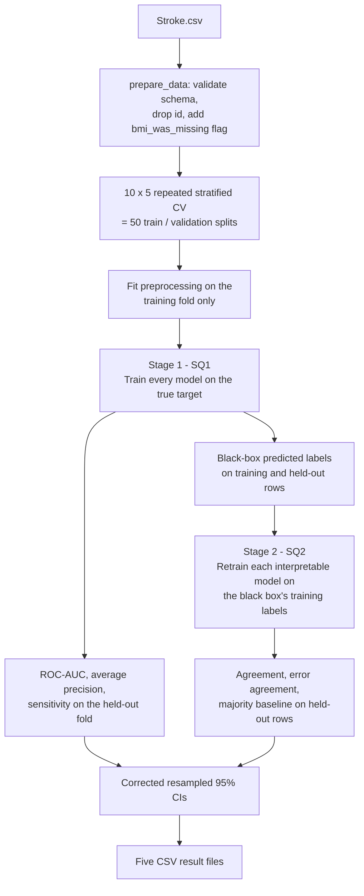

# stroke-xai-study

**Can intrinsically interpretable models match black-box models on a structured medical-style classification task, and how faithfully can they imitate them?**

This repository implements the experimental design of a Chapter 3 methodology (research design, preprocessing, models, evaluation, surrogate fidelity and statistics) on the public Kaggle *Stroke Prediction Dataset*. It compares interpretable models against black-box models under one controlled protocol, then trains the interpretable models as **global surrogates** of each black box to measure how closely they reproduce its decisions, including its mistakes.

[](https://colab.research.google.com/github/PaloMoshoeshoe/stroke-xai-study/blob/main/stroke_model_comparison_colab.ipynb)

> **Data limitation: please read.** The original source of the dataset is confidential, so its provenance cannot be verified. Results from this repository are a **methodological benchmark only**. They are not clinical evidence and must not be used for clinical decisions.

---

## Table of contents

1. [Research questions](#research-questions)
2. [Repository contents](#repository-contents)
3. [Study design at a glance](#study-design-at-a-glance)
4. [Dataset](#dataset)
5. [Preprocessing](#preprocessing)
6. [Models](#models)
7. [Evaluation protocol and metrics](#evaluation-protocol-and-metrics)
8. [Surrogate fidelity](#surrogate-fidelity)
9. [Statistical analysis](#statistical-analysis)
10. [Quick start](#quick-start)
11. [Configuration](#configuration)
12. [Outputs](#outputs)
13. [Reproducibility](#reproducibility)
14. [Project status and roadmap](#project-status-and-roadmap)
15. [Limitations](#limitations)
16. [Further reading](#further-reading)
17. [Licence and acknowledgements](#licence-and-acknowledgements)

---

## Research questions

**Main question.** To what extent can intrinsically interpretable machine-learning models match the predictive performance of black-box models and reproduce their predictions, *including their errors*, on a structured binary classification dataset?

| | Sub-question | Answered by |
|---|---|---|
| **SQ1** | How large is the difference in discrimination (ROC-AUC) between each interpretable model and each black-box model, and how precisely can that difference be estimated? | Stage 1: performance comparison |
| **SQ2** | How closely do interpretable models reproduce each black-box model's decisions, errors included, when trained on the black box's predicted labels? | Stage 2: surrogate fidelity |

The two questions are related but not interchangeable: a model can score well on the original task and still be a poor surrogate for another model, or the reverse. They are therefore analysed separately.

---

## Repository contents

| File | Purpose |
|---|---|
| `core.py` | The whole implementation: data validation, fold-local preprocessing, model definitions, cross-validation loop, fidelity measurement, corrected confidence intervals and summaries. Can be imported on its own. |
| `stroke_model_comparison_colab.ipynb` | Step-by-step Google Colab notebook that runs the experiment with `core.py`, displays the tables and exports the results as CSV/ZIP. |
| `Stroke.csv` | The Kaggle Stroke Prediction Dataset (5,110 rows, 12 columns). |
| `README.md` | This file. |

---

## Study design at a glance

The study is a quantitative, experimental model comparison. Every model sees identical data partitions, preprocessing and metrics, so differences can be attributed to the models rather than to the evaluation set-up.



**Stage 1 (performance).** All models are trained against the real stroke label and compared on discrimination.

**Stage 2 (fidelity).** For each black-box model, each interpretable model is retrained on the black box's *predicted* labels and evaluated on how often it agrees with the black box on held-out data. With three black boxes and three interpretable models this gives nine surrogates per fold (twelve once GOSDT is added).

---

## Dataset

[Stroke Prediction Dataset](https://www.kaggle.com/datasets/fedesoriano/stroke-prediction-dataset) (Kaggle, *fedesoriano*), supplied here as `Stroke.csv`.

| Property | Value |
|---|---|
| Records | 5,110 |
| Columns | 12 (including `id`, which is dropped) |
| Target | `stroke` (1 = stroke, 0 = no stroke) |
| Positive cases | 249 (about 4.9%), so the classes are **heavily imbalanced** |
| Missing values | `bmi` is missing for 201 records |

| Variable | Type | Role in the code |
|---|---|---|
| `age` | continuous | numeric |
| `avg_glucose_level` | continuous | numeric |
| `bmi` | continuous (201 missing) | numeric, median-imputed |
| `hypertension` | binary | binary |
| `heart_disease` | binary | binary |
| `bmi_was_missing` | binary (derived) | binary, created in `prepare_data` |
| `gender` | categorical | one-hot |
| `ever_married` | categorical | one-hot |
| `work_type` | categorical | one-hot |
| `residence_type` | categorical (`Residence_type` in the CSV; column names are lower-cased) | one-hot |
| `smoking_status` | categorical | one-hot |
| `id` | identifier | dropped |
| `stroke` | binary target | separated as `y` |

`prepare_data` validates that all required columns exist and that `stroke` contains only 0/1 values, and raises a clear error otherwise.

---

## Preprocessing

Preprocessing is applied **inside every cross-validation fold**: each step is fitted on the training portion only and then applied unchanged to the validation portion. This prevents data leakage.

| Feature group | Steps (fitted on the training fold) |
|---|---|
| Numeric (`age`, `avg_glucose_level`, `bmi`) | median imputation, then z-score standardisation |
| Binary (`hypertension`, `heart_disease`, `bmi_was_missing`) | passed through unchanged |
| Categorical (five columns) | most-frequent imputation, then one-hot encoding (`handle_unknown="ignore"`) |

The `bmi_was_missing` flag is created once from each row's own missingness (it uses no information from other rows, so it cannot leak). It lets a model learn whether missingness is itself informative. This choice suits a *prediction* study; the flag's coefficient should not be interpreted causally.

**Class imbalance.** Balanced class weights are used for every model, either through `class_weight` or through balanced `sample_weight` (see the table below).

---

## Models

Seven model slots are defined. All are **base-level**: no hyperparameter search is performed, which keeps the comparison controlled and reproducible. The goal is general patterns of performance and fidelity, not maximising any single model's score.

### Intrinsically interpretable

| Model | Configuration | Imbalance handling |
|---|---|---|
| L1-regularised logistic regression | `liblinear`, `max_iter=3000` | `class_weight="balanced"` |
| Explainable Boosting Machine (EBM) | `interactions=2`, `outer_bags=8`, `max_rounds=5000`; **optional**, needs the `interpret` package | balanced `sample_weight` |
| Depth-limited CART | `max_depth=4` | `class_weight="balanced"` |
| GOSDT | **planned**, not yet implemented | n/a |

### Black-box

| Model | Configuration | Imbalance handling |
|---|---|---|
| Random forest | 300 trees, `min_samples_leaf=2` | `class_weight="balanced_subsample"` |
| Gradient boosting | 100 estimators, `learning_rate=0.05`, `max_depth=2` | balanced `sample_weight` |
| Multilayer perceptron | hidden layers (64, 32), `alpha=0.001`, early stopping, `max_iter=500` | balanced `sample_weight` |

EBM is included only when `interpret` is installed. If it is missing or fails on a split, a warning is raised and it is omitted; omitted models must **not** be described as evaluated. A failure in any core model stops the run, so incomplete results are never mistaken for full ones.

---

## Evaluation protocol and metrics

**Cross-validation.** 10-fold stratified cross-validation repeated 5 times with different random splits (`RepeatedStratifiedKFold`), giving **50 evaluation results per model**. Stratification preserves the roughly 5% positive rate in every fold. The same splits are used for every model. With only about 25 positive cases per validation fold, small differences between models are hard to resolve, which is one reason the study reports confidence intervals.

| Metric | Role | Notes |
|---|---|---|
| **ROC-AUC** | primary | Ability to rank positive cases above negative ones. |
| **Average precision** (PR-AUC summary) | secondary | More informative than ROC-AUC when positives are rare. |
| **Sensitivity** | secondary | Proportion of true stroke cases found, computed at each estimator's **default classification threshold**. |

Accuracy is deliberately **not** a headline metric: with about 5% positives, a model that always predicts "no stroke" would score about 95% while finding no stroke at all. Because sensitivity uses each estimator's default threshold, compare it across models with care.

---

## Surrogate fidelity

For each black-box model *B* and each interpretable model *S*, in every fold:

1. Obtain *B*'s predicted labels on the **training** rows.
2. Retrain a fresh copy of *S* on those predicted labels (not on the true labels).
3. Predict on the held-out rows and compare with *B*'s held-out predictions.

| Measure | Definition |
|---|---|
| `agreement` | Share of held-out rows on which the surrogate predicts the same label as the black box. |
| `error_agreement` | Among held-out rows the **black box gets wrong**, the share on which the surrogate returns the *same (incorrect)* label. Undefined (`NaN`) in a fold where the black box makes no mistakes. |
| `majority_baseline_agreement` | Agreement of a trivial surrogate that always predicts the black box's most common training label. A reference point for judging real surrogates. |
| `black_box_error_count` | Number of held-out black-box errors in the fold (the denominator behind `error_agreement`). |

Error agreement is reported separately because a surrogate that reproduces a black box's errors is *more faithful* to it than one that copies only its correct predictions. Fidelity is a **diagnostic**, not a quantity to maximise: a perfectly faithful surrogate of a bad model is faithful but still inaccurate on the real task.

---

## Statistical analysis

The 50 resampled results share training data and are therefore **not independent**, so a naive standard error would be too small. Confidence intervals use the **Nadeau–Bengio corrected resampled t-interval**, which inflates the variance of the fold values by

```
(1/J + n_test / n_train)
```

where `J` is the number of resamples (50) and `n_test / n_train = 1/9` for 10-fold cross-validation. The interval is `mean ± t(0.975, J-1) × sqrt((1/J + n_test/n_train) × s²)`, implemented in `corrected_resampled_ci`.

* **SQ1:** per-fold ROC-AUC differences (interpretable minus black-box) for every pair, with 95% corrected intervals.
* **SQ2:** mean `agreement` and mean `error_agreement` per (black box, surrogate) pair with 95% corrected intervals. Error-agreement intervals use only folds with at least one black-box error, and the effective fold count is reported (`error_agreement_n_folds`).

The intervals are approximate and describe sampling variability on this dataset. They are not clinical uncertainty intervals.

---

## Quick start

### Option A: Google Colab (no local set-up)

1. Click the **Open in Colab** badge at the top of this page.
2. In the first cell of a fresh runtime, clone the repository so that `core.py` and `Stroke.csv` are available:

   ```python
   !git clone https://github.com/PaloMoshoeshoe/stroke-xai-study.git
   %cd stroke-xai-study
   ```
3. Run the notebook top to bottom. When asked, choose `upload` and select `Stroke.csv` (the exact filename is required), or choose `drive` and give the Drive path.
4. Download the generated ZIP of CSV results from the last step.

### Option B: Run locally

```bash
git clone https://github.com/PaloMoshoeshoe/stroke-xai-study.git
cd stroke-xai-study

python -m venv .venv && source .venv/bin/activate      # Windows: .venv\Scripts\activate
pip install "numpy>=1.24" "pandas>=2.0" "scipy>=1.10" "scikit-learn>=1.7"
pip install interpret                                   # optional: adds the EBM
```

```python
import pandas as pd
from core import prepare_data, run_experiment, summarize_results

X, y = prepare_data(pd.read_csv("Stroke.csv"))

# Full design from the methodology: 10 folds x 5 repeats = 50 splits
model_results, fidelity_results = run_experiment(X, y, n_splits=10, n_repeats=5, seed=42)

summaries = summarize_results(model_results, fidelity_results, n_splits=10, n_repeats=5)
print(summaries["performance_summary"].round(3))
print(summaries["auc_comparisons"].round(3))
print(summaries["fidelity_summary"].round(3))
```

For a quick sanity check use `n_splits=3, n_repeats=1`. The EBM is by far the slowest model, so runs without `interpret` finish in seconds while a full run with it can take a long time.

---

## Configuration

| Setting | Where | Default | Meaning |
|---|---|---|---|
| `SEED` | `core.py` | `42` | Master seed for the CV splitter and model seeds. |
| `QUICK_RUN` | notebook | `False` | `True` runs 10 splits (1 repeat); `False` runs the full 50 splits. |
| `N_SPLITS`, `N_REPEATS` | notebook / `run_experiment` | `10`, `5` | Cross-validation design. |
| Model hyperparameters | `build_models()` in `core.py` | see [Models](#models) | Edit here; keep them untuned to preserve the base-level design. |

---

## Outputs

The notebook writes five CSV files to `/content/Downloads/stroke_model_comparison_results/` and bundles them into `/content/Downloads/stroke_model_comparison_results.zip`. Results are generated by running the notebook; they are not stored in this repository.

| File | Granularity | Main columns |
|---|---|---|
| `model_fold_results.csv` | one row per model per split | `split`, `model`, `roc_auc`, `average_precision`, `sensitivity` |
| `fidelity_fold_results.csv` | one row per (black box, surrogate) per split | `split`, `black_box`, `surrogate`, `agreement`, `error_agreement`, `majority_baseline_agreement`, `black_box_error_count` |
| `performance_summary.csv` | one row per model | `roc_auc_mean`, `roc_auc_sd`, `average_precision_mean`, `sensitivity_mean`, `n_folds` |
| `auc_comparisons.csv` | one row per (interpretable, black box) pair | `mean_difference`, `ci_low`, `ci_high`, `n_folds` |
| `fidelity_summary.csv` | one row per (black box, surrogate) pair | `agreement_mean/ci_low/ci_high`, `error_agreement_mean/ci_low/ci_high`, `*_n_folds`, `majority_baseline_mean`, `mean_black_box_errors` |

**Reading `auc_comparisons.csv`:** `mean_difference` is *interpretable minus black-box* ROC-AUC. A confidence interval that contains 0 means the data do not show a clear difference between the two models.

---

## Reproducibility

* Fixed seed `42`: the CV splitter is seeded directly, and stochastic estimators use seeds derived deterministically from `42` and the split index.
* Preprocessing is fitted within training folds only.
* All models are evaluated on the same repeated stratified splits.
* No hyperparameter search is performed.
* When reporting results, record the Colab runtime or machine, the package versions (`pip freeze`), the value of `QUICK_RUN`, and whether `interpret` (EBM) was available.

---

## Project status and roadmap

- [x] Fold-local preprocessing and missing-BMI indicator
- [x] L1 logistic regression, depth-limited CART, optional EBM
- [x] Random forest, gradient boosting and MLP as black boxes
- [x] 10 x 5 repeated stratified cross-validation
- [x] ROC-AUC, average precision and sensitivity
- [x] Surrogate fidelity with error agreement and a majority baseline
- [x] Nadeau–Bengio corrected confidence intervals and CSV export
- [ ] **GOSDT** (optimal sparse decision trees) as the fourth interpretable model
- [ ] `requirements.txt` with pinned versions
- [ ] Results tables and figures for the thesis chapters

---

## Limitations

1. **Single, imbalanced dataset.** About 5% positives (roughly 25 per validation fold) limits how precisely small differences can be resolved, and one dataset limits generalisability.
2. **Unverifiable provenance.** The dataset's source is confidential, so no clinical conclusions can be drawn.
3. **Base-level black boxes.** They are not hyperparameter-tuned, so their performance may be underestimated.
4. **Surrogate training labels.** Surrogates learn from the black box's predictions on its own *training* rows. Models that nearly memorise their training data (such as a random forest) produce training labels close to the true labels, which can make their fidelity estimates noisy.
5. **Default-threshold sensitivity.** Sensitivity depends on each estimator's default threshold and is not directly comparable across all models.
6. **Optional EBM.** Results differ depending on whether `interpret` was available in the runtime.

---

## Further reading

Selected works relevant to the methods used here (2016 onwards). The corrected resampled t-test is named after Nadeau and Bengio, who proposed it; Benavoli et al. discuss it in an applied setting.

* Rudin, C. (2019). Stop explaining black box machine learning models for high stakes decisions and use interpretable models instead. *Nature Machine Intelligence, 1*(5), 206–215.
* Guidotti, R., Monreale, A., Ruggieri, S., Turini, F., Giannotti, F., & Pedreschi, D. (2018). A survey of methods for explaining black box models. *ACM Computing Surveys, 51*(5), Article 93.
* Chang, C.-H., Tan, S., Lengerich, B., Goldenberg, A., & Caruana, R. (2021). How interpretable and trustworthy are GAMs? *Proceedings of the 27th ACM SIGKDD Conference on Knowledge Discovery & Data Mining*, 95–105.
* Lin, J., Zhong, C., Hu, D., Rudin, C., & Seltzer, M. (2020). Generalized and scalable optimal sparse decision trees. *Proceedings of the 37th International Conference on Machine Learning* (PMLR 119), 6150–6160.
* Benavoli, A., Corani, G., Demšar, J., & Zaffalon, M. (2017). Time for a change: A tutorial for comparing multiple classifiers through Bayesian analysis. *Journal of Machine Learning Research, 18*(77), 1–36.
* Haixiang, G., Yijing, L., Shang, J., Mingyun, G., Yuanyue, H., & Bing, G. (2017). Learning from class-imbalanced data: Review of methods and applications. *Expert Systems with Applications, 73*, 220–239.
* Richardson, E., Trevizani, R., Greenbaum, J. A., Carter, H., Nielsen, M., & Peters, B. (2024). The receiver operating characteristic curve accurately assesses imbalanced datasets. *Patterns, 5*(6), 100994.
* Kapoor, S., & Narayanan, A. (2023). Leakage and the reproducibility crisis in machine-learning-based science. *Patterns, 4*(9), 100804.

---

## Licence and acknowledgements

* **Licence:** not yet specified. Add a `LICENSE` file (for example MIT) before others reuse the code.
* **Data:** the Stroke Prediction Dataset is distributed on Kaggle by *fedesoriano*; please respect the terms on the Kaggle dataset page.
* **Software:** built with scikit-learn, pandas, NumPy, SciPy and (optionally) InterpretML.
* **Author:** [@PaloMoshoeshoe](https://github.com/PaloMoshoeshoe)
